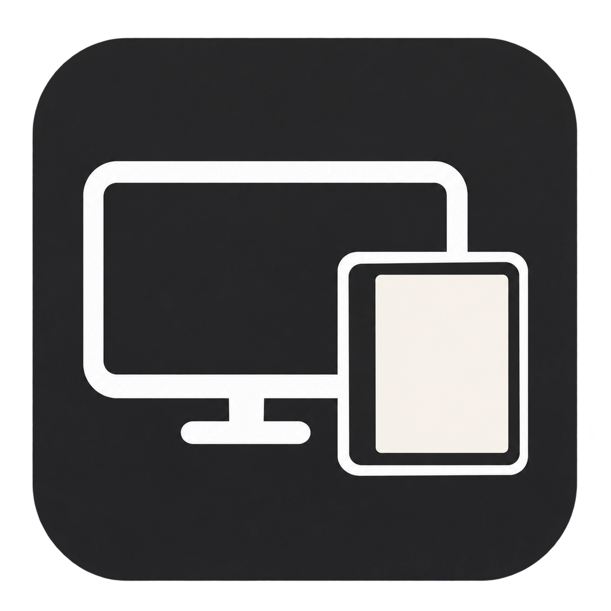
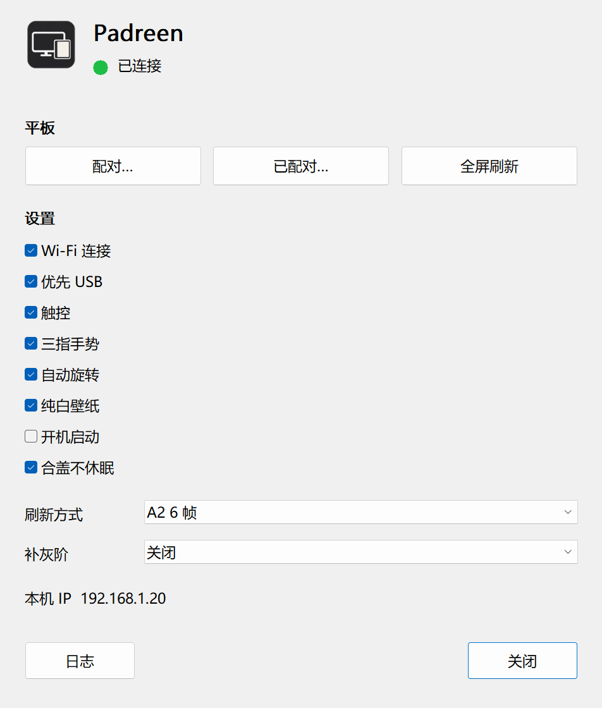

# Padreen

把华为 MatePad Paper（墨水屏平板）变成 Windows 电脑的第二块显示器：窗口拖到平板上，用手指直接点按、拖动。

## 特点

- 极速刷新，约 0.1 秒一次；停手后自动补灰阶
- 触控：点按、拖动、长按（右键）、双指缩放、三指手势
- 平板竖过来，电脑上这块屏也自动变竖屏
- Wi-Fi（配对码）或 USB 线连接，平板无需 root

## 展示

## 使用

需要：Windows 10/11（64 位）、华为 MatePad Paper。

1. 在 [Releases](https://github.com/1031193940/Padreen/releases) 下载 `Padreen-Setup-*.exe`，安装并运行。
2. 平板打开「USB 调试」，用数据线连电脑，在平板上点「允许」。平板 App 会自动安装（点一次「继续安装」）。
3. 首次运行时按提示安装虚拟显示器驱动：它是 Parsec 的软件，不随 Padreen 分发，由程序从 Parsec 官网下载（需要联网）。
4. 电脑上多出一块屏，把窗口拖过去即可。

**Wi-Fi 连接**：电脑托盘图标 →「配对…」，在平板上打开 Padreen，点电脑旁的「配对」，输入屏幕上的数字。之后自动连接。

**三指手势**：轻点 = 整屏刷新，上滑 = 多桌面（Win+Tab），下滑 = 切换窗口。
